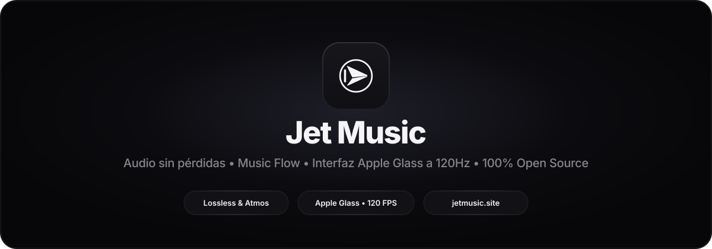
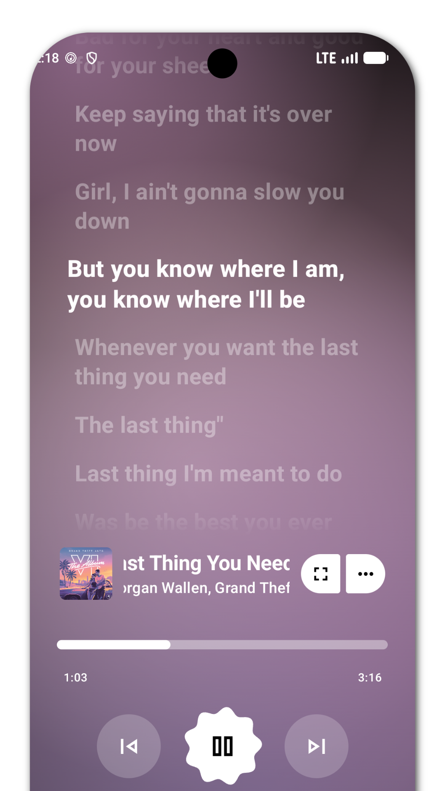
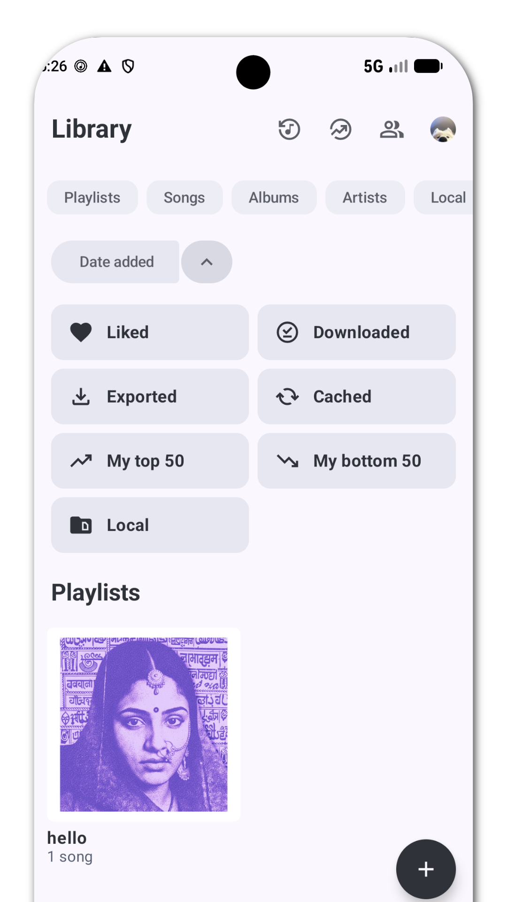

<div align="center">
  <a href="https://jetmusic.site">
    
  </a>

  <br />
  <br />

  <p>
    <a href="https://jetmusic.site"></a>
    <a href="https://github.com/sepuro/Jet-Music/releases/latest"></a>
    <a href="https://github.com/sepuro/Jet-Music/actions/workflows/android-build.yml"></a>
    <a href="LICENSE"></a>
  </p>

  <p>
    <b>Reproductor de música minimalista de alto rendimiento para Android.</b><br />
    Audio sin pérdidas • Dolby Atmos • Music Flow • Letras sincronizadas a 120Hz • Cápsulas Apple Glass • 100% Open Source y sin anuncios.
  </p>

  <p>
    <a href="https://jetmusic.site"><b>🌐 Sitio Web Oficial (jetmusic.site)</b></a>
    &nbsp;•&nbsp;
    <a href="https://github.com/sepuro/Jet-Music/releases/latest"><b>⬇️ Descargar APK v1.7.0 (Release Firmado)</b></a>
    &nbsp;•&nbsp;
    <a href="#características-principales"><b>✨ Características</b></a>
    &nbsp;•&nbsp;
    <a href="#arquitectura-y-compilación"><b>🛠️ Compilación</b></a>
  </p>
</div>

---

## Descripción General

**Jet Music** combina una arquitectura de audio de grado audiófilo con una interfaz minimalista inspirada en **Apple Music**, diseñada sobre **Jetpack Compose** y **Media3** para ejecutarse a **120 FPS constantes** sin recomposiciones innecesarias.

Cada versión se compila en modo `Release` optimizado con **R8 Full Mode**, utilizando el identificador de paquete exclusivo `app.jetmusic.android` y verificación criptográfica obligatoria mediante `apksigner` (**APK Signature Scheme v2 y v3**) en GitHub Actions.

---

## Características Principales

### 1. Audio sin pérdidas & Dolby Atmos
- **Streaming Lossless y Hi-Res**: Reproducción de flujos FLAC y ALAC sin compresión de hasta **24-bit / 192 kHz**.
- **Pipeline Bit-Perfect por USB DAC**: Derivación directa del mezclador de Android para enviar audio puro al convertidor digital-analógico externo.
- **Motor DSP Nativo y Dolby Atmos**: Ecualizador paramétrico de 10 bandas con espacialización acústica y telemetría en tiempo real para códecs Bluetooth de alta resolución (**LDAC**, **aptX HD**, **LC3**).
- **Insignias de Formato en Vivo**: Indicadores precisos de calidad (`FLAC`, `Hi-Res`, `Bit-Perfect`, `Dolby Atmos`) integrados en la pantalla de reproducción.

### 2. Music Flow & Letras Sincronizadas en Tiempo Real
- **Modo Music Flow (Video Canvas)**: Transición instantánea y fluida entre reproducción de audio puro y lienzos de video sincronizados.
- **Letras Sincronizadas Sílaba por Sílaba**: Seguimiento en tiempo real con jerarquía tipográfica estilo *San Francisco Display* (`FontWeight.ExtraBold` en la línea activa, escala reactiva y transición suave).
- **Traducción Integrada**: Traducción automática de letras dentro del reproductor sin interrumpir la experiencia visual.

### 3. Interfaz Minimalista a 120Hz (Light & Dark)
- **Aislamiento Total del Estado de Reproducción**: Lectura diferida mediante lambdas proveedoras en la fase de dibujado (`drawWithContent` / `graphicsLayer`), garantizando **0 recomposiciones** en `HomeScreen` mientras avanza la canción o se hace scroll.
- **Carátula Reactiva con Físicas de Resorte**: En el reproductor expandido, la portada responde dinámicamente al estado de reproducción (`scale = 1.0f` y sombra de `24.dp` al reproducir; `scale = 0.85f` y sombra de `8.dp` en pausa) usando `spring(DampingRatioLowBouncy, StiffnessLow)`.
- **Cápsulas Flotantes en Acabado Apple Glass**: `MiniPlayer` y barra de navegación inferior con superficies translúcidas de alto contraste (`#141416` en Dark / `#F5F5F7` en Light) y borde especular biselado de `0.8.dp`, pre-cacheados con `Modifier.drawWithCache`.

### 4. Actualizaciones OTA Integradas & 100% Open Source
- **Actualizador OTA Nativo**: Verificación automática al iniciar la app y manual desde Ajustes contra la API oficial de GitHub Releases (`/repos/sepuro/Jet-Music/releases/latest`) con comparador semántico estricto (`major.minor.patch`).
- **Descarga e Instalación Directa**: Hoja modal minimalista con notas de la versión, barra de progreso real e invocación directa del instalador del sistema vía `FileProvider` (`${applicationId}.fileprovider`).
- **Privacidad Absoluta**: 100% libre de anuncios, suscripciones y rastreadores comerciales.

---

## Capturas de Interfaz

<div align="center">
  <table>
    <tr>
      <td align="center">
        <b>Reproductor Estilo Apple Music</b><br /><br />
        
      </td>
      <td align="center">
        <b>Letras Sincronizadas 120Hz</b><br /><br />
        
      </td>
      <td align="center">
        <b>Cápsulas Flotantes Apple Glass</b><br /><br />
        
      </td>
    </tr>
    <tr>
      <td align="center">
        <b>Reproductor Material</b><br /><br />
        
      </td>
      <td align="center">
        <b>Explorar y Buscar</b><br /><br />
        
      </td>
      <td align="center">
        <b>Biblioteca Musical</b><br /><br />
        
      </td>
    </tr>
  </table>
</div>

---

## Instalación

### Descarga Directa (Recomendado)
1. Visita la web oficial **[https://jetmusic.site](https://jetmusic.site)** o la página de **[GitHub Releases](https://github.com/sepuro/Jet-Music/releases/latest)**.
2. Descarga el archivo firmado **`Jet-Music-v1.7.0-release.apk`**.
3. Instala el APK en tu dispositivo Android (Android 8.0 / API 26 o superior, arquitecturas `arm64-v8a` y `armeabi-v7a`).
4. Las versiones posteriores se notifican e instalan directamente desde el **sistema OTA integrado** dentro de la aplicación.

---

## Arquitectura y Compilación

<details>
<summary><b>Compilar desde el código fuente (Modo Release Optimizado)</b></summary>
<br />

1. **Clonar el repositorio**
   ```bash
   git clone https://github.com/sepuro/Jet-Music.git
   cd Jet-Music
   ```

2. **Configurar Android SDK**
   Define la ruta de tu SDK en `local.properties`:
   ```bash
   echo "sdk.dir=/ruta/a/tu/android/sdk" > local.properties
   ```

3. **Ejecutar compilación Release firmada (R8 + Resource Shrinking)**
   ```bash
   ./gradlew lintVitalUniversalFossRelease assembleUniversalFossRelease --stacktrace
   ```

4. **Verificar firma criptográfica v2/v3 y metadatos del APK**
   ```bash
   apksigner verify --verbose --print-certs app/build/outputs/apk/universalFoss/release/*.apk
   aapt2 dump badging app/build/outputs/apk/universalFoss/release/*.apk | grep -E "package:|launchable-activity:"
   ```

</details>

| Especificación Técnica | Valor Oficial |
| :--- | :--- |
| **Nombre de la Aplicación** | `Jet Music` |
| **Application ID (`package`)** | `app.jetmusic.android` |
| **Versión Actual** | `1.7.0` (`versionCode = 170`) |
| **SDK Mínimo / Objetivo / Compilación** | `minSdk 26` • `targetSdk 36` • `compileSdk 37` |
| **Arquitecturas Nativas (ABI)** | `arm64-v8a`, `armeabi-v7a` |
| **Esquema de Firma** | `APK Signature Scheme v2 & v3` (`RSA 2048-bit`) |
| **Dominio Web Oficial** | [https://jetmusic.site](https://jetmusic.site) |

---

## Aviso Legal y Licencia

1. **100% Gratuito, Open Source y No Comercial**: Jet Music es un proyecto de software libre publicado bajo la licencia [GPL-3.0](LICENSE) con fines educativos y de uso personal. No contiene anuncios, suscripciones ni monetización.
2. **Sin Alojamiento de Contenido**: Jet Music no almacena, aloja ni distribuye archivos multimedia con derechos de autor en servidores propios; funciona exclusivamente como un cliente especializado sobre flujos públicos.

---

<div align="center">
  <p>
    <a href="https://jetmusic.site"><b>jetmusic.site</b></a> • <a href="https://github.com/sepuro/Jet-Music"><b>github.com/sepuro/Jet-Music</b></a> • Licenciado bajo <a href="LICENSE"><b>GPL-3.0</b></a>
  </p>
</div>
